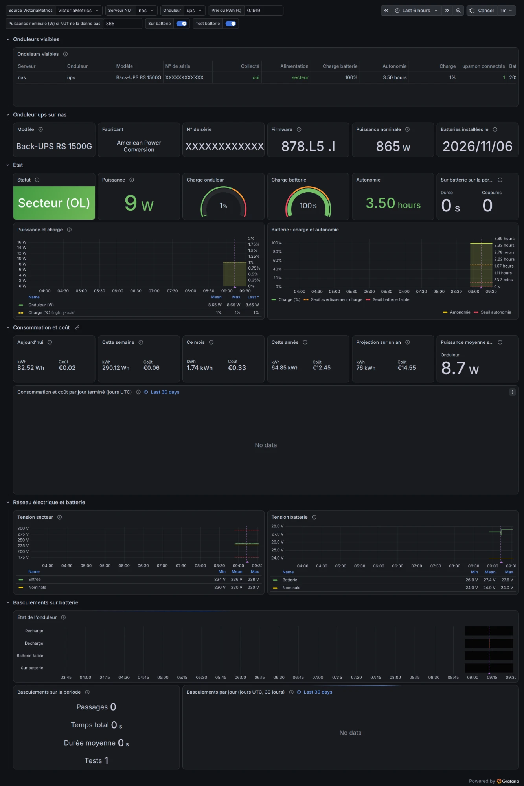

# nut-exporter

Prometheus exporter for Network UPS Tools (upsd). It exports every variable of every UPS of one
or more upsd servers, without listing variables and without altering values, plus logins,
client addresses, instant commands, writable variables and their constraints. Read-only: it
sends no SET, INSTCMD or LOGIN and needs no NUT credentials. Design: `docs/design.md`.

## Run

```sh
nut-exporter -nut.server 127.0.0.1:3493                  # server label "default"
nut-exporter -nut.server 127.0.0.1:3493 -nut.name nas    # server label "nas"
nut-exporter -config nut-exporter.yml
```

| Endpoint | Content |
|---|---|
| `/metrics` | Prometheus metrics, collected at scrape time |
| `/inventory` | JSON snapshot: every raw value, metadata, query state and export decision |

Set the scraper timeout above `timeouts.scrape` (10 s by default). The listener is `:9199` (all
interfaces) by default; `/inventory` holds serials and descriptions, so restrict it with
`listen: 127.0.0.1:9199` or a firewall where the network is not private.

### Container image

`ghcr.io/disaster/nut-exporter:<version>` (linux/amd64, linux/arm64), published for each release
tag `vX.Y.Z` as `X.Y.Z` (immutable; also `sha-<commit>`), with an SBOM and build provenance; no
`latest` or other moving tag. Distroless, runs as `nonroot` (65532), listens on `:9199`; publish
the port on a private address only.

```sh
docker run -d --name nut-exporter -p 127.0.0.1:9199:9199 \
  ghcr.io/disaster/nut-exporter:<version> -nut.server=192.0.2.10:3493
```

```yaml
services:
  nut-exporter:
    image: ghcr.io/disaster/nut-exporter:<version>
    command: ["-config", "/etc/nut-exporter/config.yml"]
    volumes: ["./nut-exporter.yml:/etc/nut-exporter/config.yml:ro"]
    ports: ["127.0.0.1:9199:9199"]
    restart: unless-stopped
```

The configuration file must be readable by UID 65532. Licence files of everything compiled in are
under `/licenses`.

## Metrics

Every UPS-scoped series has `server` (configured name; with `-nut.server`, `-nut.name` or
`default`, never the address, so that a new address or a move to a configuration file with the
same `name` keeps the series) and `ups` labels.

| Metric | Content |
|---|---|
| `nut_<name>[_<unit>]` | numeric variables named in the NUT catalogue (`docs/nut-names.txt`): `nut_battery_charge_percent`, `nut_battery_runtime_seconds`, `nut_input_voltage_volts{phase}`, `nut_ambient_temperature_celsius{ambient}`, `nut_outlet_current_amperes{outlet}`; value in NUT units, never converted |
| `nut_variable_value{variable}` | numeric variables outside the catalogue (`experimental.*`, vendor names) |
| `nut_variable_info{variable,value}` | text variables, value verbatim (`0002`, trailing spaces) |
| `nut_variable_timestamp_seconds{variable}` | `*.date` variables in `YYYY-MM-DD` or `YYYY/MM/DD` |
| `nut_device_info{model,mfr,serial,type,part,macaddr}` | hardware identity from `device.*`, or `ups.model`/`ups.mfr`/`ups.serial` when `device.*` is absent or empty; values verbatim |
| `nut_ups_status{flag}` | `ups.status` flags, 0 or 1, only when `ups.status` was read: the documented flags (`OL OB LB HB RB CHRG DISCHRG BYPASS CAL OFF OVER TRIM BOOST FSD ALARM WAIT`) always, an unknown flag from its first appearance on; several are set at once (`OB DISCHRG LB`) |
| `nut_ups_logins`, `nut_ups_client_sessions{address}` | sessions logged in (upsmon) |
| `nut_ups_command_info{command}` | supported instant commands |
| `nut_variable_writable`, `nut_variable_type_info`, `nut_variable_enum_info`, `nut_variable_range_info` | variable metadata |
| `nut_server_up`, `nut_ups_up`, `nut_query_success{query}`, `nut_query_error_info{query,error}` | collection health |
| `nut_suppressed{family,reason}`, `nut_server_suppressed{reason}` | series not exported by a filter or guard |

A variable is a gauge when its name is not a documented opaque or enumerated field (serials, IDs,
dates, firmware, versions, statuses, yes/no and on/off settings...) and its value is a NUT number,
spaces around it allowed; otherwise it is text. A NUT number is what drivers print with `%f`:
`.5`, `120.` and `1.2e4` are text (NUT forbids exponents; `2e66` in a dump is a hexadecimal USB
ID). Override with `classify.numeric` / `classify.text`; a variable named in `classify.numeric`
also accepts a sign, a leading or trailing decimal point and an exponent, never hexadecimal,
`Inf`, `NaN` or a value out of `float64` range. A gauge
takes its catalogue name when NUT documents it, `nut_variable_value` otherwise; each value is
exported once, except the identity repeated in `nut_device_info`. `/inventory` gives the metric
of every variable (`metric`). The unit suffix is the one NUT states; where NUT states none
(`battery.voltage.low`) there is no suffix. The suffix is the declared unit, not a checked one:
values pass through unchanged, including driver defects (a temperature in kelvins, 255
sentinels); quarantine such a variable with `classify.text` or `variables.exclude`. Three-phase values carry `phase` (`L1`, `L1-N`...),
the aggregate one `phase=""`: filter on `phase` before summing.

Examples:

```promql
nut_ups_status{flag="OB"} == 1                          # on battery
nut_ups_status{flag="OL"} == 0
  unless on(server, ups) nut_ups_status{flag="WAIT"} == 1   # off mains, not a driver restart
nut_ups_logins == 0                                     # no upsmon watches the UPS
time() - nut_variable_timestamp_seconds{variable="battery.mfr.date"} > 3 * 365 * 86400
nut_variable_info{variable="ups.beeper.status", value!="enabled"} == 1   # beeper off or muted
nut_battery_charge_percent * on(server, ups) group_left(model, serial) nut_device_info   # UPSes without identity drop out
```

## Configuration

All keys are optional except `servers`; defaults shown.

```yaml
listen: ":9199"
servers:
  - name: nas
    address: 127.0.0.1:3493
ups:        { include: ["*"], exclude: [] }
variables:  { include: ["*"], exclude: [] }
classify:   { numeric: [], text: [] }
guard:      { max_length: 1024, max_distinct: 100, churn_window: 24h, max_ups: 256, max_series: 20000 }
metadata_ttl: 10m
timeouts:   { connect: 2s, command: 2s, scrape: 10s }
limits:     { max_line: 8192, max_response: 4194304 }
workers: 2
```

Some drivers publish diagnostics under `ups.debug.*` (raw protocol frames); when they are not
needed, `variables: { exclude: ["ups.debug.*"] }` drops them. Text values that keep changing
are otherwise cut by the churn guard and counted in `nut_suppressed{reason="churn"}`.

`ups`, `variables` and `classify` apply to all servers and UPSes. To drop a series of one UPS
only (a driver reporting kelvins as `ups.temperature`), relabel in Prometheus; the raw value
stays in `/inventory`:

```yaml
metric_relabel_configs:
  - source_labels: [__name__, server, ups]
    regex: nut_ups_temperature_celsius;nas;old-ups
    action: drop
```

Generic families also carry `variable` (`nut_variable_info`, `nut_variable_value`).

## Grafana dashboard

`examples/grafana/nut-ups.json` (French labels), for Grafana 13: import it, then pick the data
source, the NUT server and the UPS. A table lists every UPS of the data source; the other panels
show the selected one: identity, status, power, battery, mains and battery voltages, transfers to
battery and the battery tests they reveal.



- It needs a VictoriaMetrics data source: some panels use MetricsQL (`share_eq_over_time`,
  `increases_over_time`).
- Power is an estimate: `ups.load` x `ups.realpower.nominal`, or the `maxwatt` variable when NUT
  gives no nominal power. Energy and cost multiply the mean power by the period: on a period
  longer than the collected history, they extrapolate.
- `kwhprice` is the price of a kWh, in euros.
- Tests are counted as discharges (`DISCHRG`) minus transfers to battery (`OB`) over the period:
  a discharge that began before the period can offset a test.

## Build and test

```sh
go test -race ./...
# Replay NUT's device dumps (git clone https://github.com/networkupstools/nut-ddl):
NUT_DDL=../nut-ddl NUT_DDL_OUT=/tmp/ddl.jsonl go test ./internal/export -run TestDDLCorpus
docker build --build-arg VERSION=<version> -t nut-exporter:<version> .
```

CI (`.github/workflows/ci.yml`) runs on every push and pull request: gofmt, vet, `go test -race`,
catalogue regeneration at the pinned NUT commit (must give `catalog_gen.go` unchanged), the
nut-ddl corpus at a pinned commit, and an image smoke test; it pushes the image only for a
`vX.Y.Z` tag. Dependabot (`.github/dependabot.yml`) proposes weekly updates of Go modules,
actions and base images.

## Licence

Apache License 2.0 (`LICENSE`). `NOTICE` states the provenance of the generated NUT catalogue
(names and units from NUT's GPL-2.0-or-later `docs/nut-names.txt`, no description text). The
container image ships the licence and notice files of every compiled-in module under
`/licenses`.
